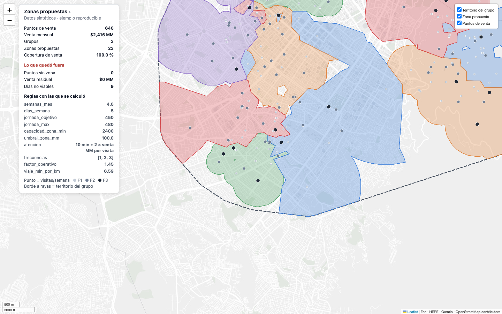
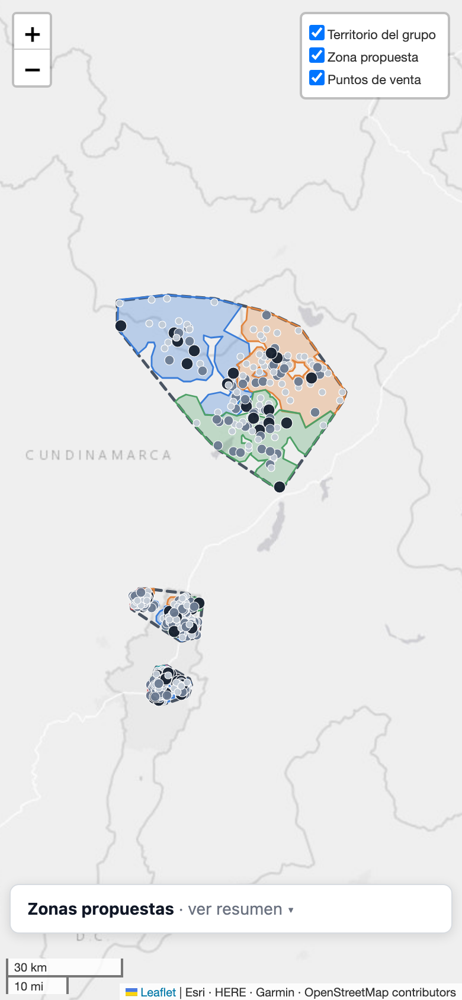

# Zonas comerciales

[](https://github.com/s-osorio-gom/zonas-comerciales/actions/workflows/pruebas.yml)

Convierte una base de puntos de venta georreferenciados en zonas que **se pagan**,
**se pueden recorrer** y se ven en un mapa que alguien nuevo entiende sin que se
lo expliquen.

No es un clustering con un mapa encima. La restricción que manda no es la
distancia: es que cada zona supere un umbral de venta **y** quepa en la jornada
de una persona, contando el desplazamiento. Las dos cosas a la vez, que es donde
se cae el k-means de manual.



<sub>Salida del ejemplo incluido, sobre datos sintéticos. Cada zona es la unión de
las celdas de Voronoi de sus puntos, recortada al área que esos puntos alcanzan:
no se solapan, cada punto cae dentro de la suya y ninguna zona vecina repite color.</sub>

## Lo que este repositorio impide hacer mal

Tres errores que parecen razonables y arruinan el resultado. Están en el diseño,
no en un documento aparte:

1. **Usar la zona actual como semilla.** Reproduce la operación que se quería
   rediseñar. Aquí cada punto entra sin zona.
2. **Calcular el tiempo de atención con la venta mensual.** Debe ser con la
   **venta por visita**: `venta mensual → frecuencia → visitas/mes → venta por
   visita → minutos`. Al revés, infla los clientes de baja frecuencia y
   subestima los de alta.
3. **Zonificar sin restringir la dispersión geográfica.** Produce zonas que
   cumplen el umbral y exigen cientos de horas de viaje por semana. La capacidad
   de una zona incluye su desplazamiento estimado, actualizado punto a punto.

El resto de los errores caros están en **[`docs/trampas.md`](docs/trampas.md)**,
con síntoma, causa y regla. Leerlo antes de tocar el motor sale más barato que
después.

## La cadena

```
PUNTOS + GEOGRAFÍA  →  GRUPO          (point-in-polygon, nunca por nombre)
        ↓
ZONAS DESDE CERO    →  venta ≥ umbral Y recorribles
        ↓
FRECUENCIA          →  visitas/mes → VENTA POR VISITA → minutos
        ↓
PLAN SEMANAL        →  los días son SECTORES geográficos, no repartos de minutos
        ↓
RUTAS               →  viaje + atención, sobre la matriz de tiempos real
        ↓
QA                  →  puede FALLAR y detener la entrega
```

## Arquitectura

| Módulo | Qué hace | Entra | Sale |
|---|---|---|---|
| `zonas/reglas.py` | todos los parámetros de negocio y las fórmulas de atención y viaje estimado | — | constantes, `minutos_visita`, `viaje_semana_min` |
| `zonas/zonificar.py` | zonas de UN grupo: k-means capacitado, reequilibrio, poda y búsqueda del número de zonas | DataFrame con `lat`, `lon`, `venta`, `frecuencia_semana` | etiqueta por punto (`-1` = sin zona) + informe |
| `zonas/plan_semanal.py` | días como sectores geográficos, equilibrio por ruta real, orden de visita (heurístico u OR-Tools) | puntos de una zona en km planos + matriz de minutos | una fila por día con secuencia, minutos y estado |
| `zonas/qa.py` | invariantes que pueden detener la entrega | puntos, zonas, plan | informe impreso + `True`/`False` |
| `ejemplo/generar_datos.py` | 640 puntos sintéticos en tres territorios | semilla | `ejemplo/datos/pdv_sinteticos.csv` |
| `ejemplo/demo.py` | la cadena completa, con una matriz de minutos en línea recta | el CSV anterior | `ejemplo/salida/`: mapa y tres CSV |
| `ejemplo/mapa.py` | mapa Folium de un solo archivo: territorio, zonas sin solapes, puntos, panel | puntos con zona, zonas, resumen | `mapa_zonas.html` |
| `ejemplo/qa_visual.py` | abre el mapa en Chromium (escritorio y teléfono) y lo revisa | `mapa_zonas.html` | capturas `qa_*.png` + código de salida |

`zonas/` no depende de `ejemplo/`: el motor no sabe de mapas ni de CSV. Todos sus
módulos leen el mismo `zonas.reglas`, así que un cambio en tiempo de ejecución lo
ve el motor entero.

## Correrlo

Requiere Python 3.12 o posterior con `venv` (probado con 3.12 y 3.14 en macOS;
el CI usa 3.12 en Linux). Dependencias:
NumPy, pandas, SciPy, Shapely, Folium y OR-Tools. OR-Tools es opcional: sin él,
el orden de visita sale del heurístico (vecino más cercano + 2-opt) y el viaje
publicado es el de ese orden. En el ejemplo eso da 10.737 min de viaje a la
semana en vez de 9.865,6 (un 8,8 % más) y 10 días no viables en vez de 9.

```bash
python3 -m venv .venv && source .venv/bin/activate
pip install -r requirements.txt
python3 ejemplo/generar_datos.py    # fabrica 640 puntos sintéticos
python3 ejemplo/demo.py             # zonifica, planifica, verifica, dibuja
open ejemplo/salida/mapa_zonas.html # en Linux: xdg-open
```

Unos 35 segundos de CPU: entre 30 y 40 s de reloj en un portátil de 8 núcleos
desocupado. La primera corrida tras instalar y una máquina cargada tardan más
(se midieron hasta 6 minutos con la CPU saturada), pero el resultado es el mismo
byte a byte. Sale con código 1 si el QA encuentra un fallo crítico: un
entregable que no cuadra no se publica. Escribe en `ejemplo/salida/` el mapa y
tres CSV: `pdv_con_zona.csv`, `zonas.csv` y `plan_semanal.csv` (un día-zona por
fila, con secuencia de visita, minutos de atención, de viaje y estado).

Salida real (extracto):

```
── ZONIFICACIÓN ────────────────────────────────────────────
  DISTRIBUIDOR CENTRO    11 zonas de 11 asesores · $ 1,139 MM capturados · podados 0 · reabsorbidos 0
  DISTRIBUIDOR NORTE      9 zonas de 9 asesores · $   942 MM capturados · podados 0 · reabsorbidos 0
  DISTRIBUIDOR RURAL      3 zonas de 4 asesores · $   334 MM capturados · podados 0 · reabsorbidos 0

── PLAN SEMANAL ────────────────────────────────────────────
  115 días-zona en 23 zonas · VIABLE 104 · NO_VIABLE 9 · ALERTA 2
  ...
  11 de 13 pruebas · 0 fallos críticos · 2 avisos
  ...
  MIN_POR_KM actual 6.59 → medido 11.43 · correlación 0.981 sobre 23 zonas
  ...
  geometría: 59 vecindades · 0 pares vecinos del mismo color (objetivo 0) · 0 zonas solapadas (objetivo 0)
```

Es decir: 23 zonas sobre tres territorios, el 100 % de la venta capturada, cero
zonas solapadas y cero pares de zonas vecinas del mismo color. Los 2 avisos son
9 días no viables y 2 en alerta en el territorio rural, que **no** son un
defecto del cálculo: son el conflicto de negocio real —el terreno exige más
asesores de los que la venta paga— y el modelo no debe resolverlo solo.

La salida es reproducible: dos corridas dan los mismos CSV byte a byte. El
solver para por número de soluciones, no por reloj (ver abajo). Con otra versión
de OR-Tools las rutas pueden diferir en décimas de punto porcentual.

### Usarlo con datos propios

```python
from zonas import reglas as R, zonificar as Z, plan_semanal as PS, qa

# 1. zonas: UN grupo por corrida. df necesita lat, lon, venta, frecuencia_semana
etiquetas, informe = Z.zonificar_grupo(df, asesores=52)    # -1 = sin zona

# 2. plan de UNA zona: P en km planos, D = minutos entre sus puntos
g = df[etiquetas == 0]
P = Z.plano(g.lat.values, g.lon.values)
D = matriz_de_minutos(g)              # la tuya: OSRM, OSMnx o un servicio de rutas
filas = PS.plan_de_zona(P, g.venta.values, g.frecuencia_semana.values, D)

# 3. QA: pdv con columna `zona` (nula si residual), zonas con `venta` agregada,
#    plan con una fila por día-zona. Con `matrices` recalcula además el viaje
#    de cada secuencia publicada. Imprime el informe y devuelve bool.
ok = qa.verificar(pdv, zonas, plan, matrices={"Z01": D})
```

`zonificar_grupo` rechaza con `ValueError` una base con columnas faltantes,
nulos, texto o booleanos donde van números, ventas o frecuencias negativas,
coordenadas fuera de rango o un número de asesores que no sea entero; el mensaje
dice qué columna revisar. Correr **un
grupo a la vez** hace que "una zona no cruza grupos" se cumpla por construcción,
en vez de tener que comprobarlo después. `ejemplo/demo.py` es la cadena completa
como referencia, incluida la matriz de minutos en línea recta.

Antes de nada, abrir **[`zonas/reglas.py`](zonas/reglas.py)**: ahí están todos los
parámetros de negocio y ningún otro módulo define una constante. Se pueden
editar en el archivo o en tiempo de ejecución (`R.UMBRAL_ZONA = 80_000_000`): todo
el motor lee el mismo módulo. Los valores de fábrica vienen de un despliegue real
de distribución a tienda de barrio, en pesos colombianos; sirven de punto de
partida, no de verdad.

## Dos cosas que se midieron, no se supusieron

**El solver no va en el bucle de decisión.** Para *decidir* —equilibrar días,
podar puntos— se usa vecino más cercano + 2-opt. Sobre cinco instancias de 22
paradas el heurístico tarda **1–2 ms**; OR-Tools con 2 s tarda **~2.000 ms** y
acorta la ruta entre 1,6 % y 13,6 % (mediana 7 %). Mil veces el tiempo por una
diferencia que no cambia qué alternativa es mejor: el solver se reserva para la
ruta final que se publica.

**El solver para por número de soluciones, no por reloj.** La búsqueda local
guiada no para cuando encuentra el óptimo: agota el presupuesto que se le dé. Con
un límite de tiempo, el resultado depende de cuánta CPU le toque: tres corridas
de la misma base daban tres planes distintos. Sobre los 115 días del ejemplo
(mediana 8 paradas, máximo 31):

| Criterio de parada | Tiempo | Ruta total | ¿Mismo plan al repetir? |
|---|---|---|---|
| Reloj plano, 1 s por día | 113,0 s | 9.864,2 min | no medido |
| Reloj por tamaño del día | 32,7 s | 9.848–9.866 min | no |
| **200 soluciones por día** (actual) | **25–31 s** | **9.865,6 min** | **sí** |
| 1.000 soluciones por día | 142–145 s | 9.837,1 min | sí |

Las 1.000 soluciones acortan la ruta un 0,3 % por cinco veces el tiempo. Pasar
`segundos=` a `plan_de_zona` u `orden_optimo` vuelve al límite de reloj.

**Y el estimador de viaje se calibra, no se supone.** Dentro de la zonificación
aún no hay ruta que medir, así que se estima con Beardwood–Halton–Hammersley.
Esa constante es inventada hasta que se contrasta contra rutas ya calculadas:
`Z.calibrar_viaje()` lo hace y el ejemplo lo corre al final (correlación 0,981
sobre 23 zonas; sobre los datos sintéticos propone subir `MIN_POR_KM` de 6,59 a
11,43; el ejemplo lo imprime y no lo aplica solo).

## Verificación

```bash
python3 pruebas.py                     # 36 comprobaciones (invariantes y regresiones), ~10 s
pip install ruff==0.17.0 && ruff check .   # análisis estático, reglas en ruff.toml
python3 ejemplo/qa_visual.py           # abre el mapa en Chromium: escritorio y teléfono
```

El CI (`.github/workflows/pruebas.yml`) corre `ruff`, `pruebas.py` y la cadena
completa de `demo.py` en cada push a `main` y en cada pull request.

`qa_visual.py` automatiza el protocolo de **[`docs/mapa.md`](docs/mapa.md)** hasta
donde se puede: errores de JavaScript, peticiones fallidas, formas dibujadas,
`NaN` en pantalla, controles de zoom tapados (en 1440×900 y en un teléfono de
390×844, vertical y apaisado), panel abierto al cargar en el teléfono y scroll
horizontal. El último paso no es automatizable —hay que **mirar las
capturas**— y es el que encuentra lo que importa. En este repositorio encontró
así que el fondo de mapa por defecto de Folium había pasado a exigir llave y
estampaba «API KEY REQUIRED» sobre todo el mapa, con cero errores en consola.

Requiere `pip install "playwright==1.63.*" && playwright install chromium`, haber
corrido `demo.py` antes y red para las teselas del fondo. Sale con código 1 si hay
errores de JavaScript, ninguna forma dibujada, `NaN` en pantalla, un bloque del
panel ausente o un control tapado. Guarda `qa_01_general.png`, `qa_02_zona.png` y
`qa_03_movil.png` y `qa_04_movil_apaisado.png`.



<sub>En un teléfono, vertical o apaisado, el panel arranca plegado al pie («ver resumen ▾»).</sub>

## Qué NO hace

- **No trae cartografía.** Los polígonos oficiales (en Colombia, el Marco
  Geoestadístico del DANE) se descargan aparte. El ejemplo usa envolventes como
  sustituto y lo dice en el código.
- **No calcula distancias sobre red vial.** El ejemplo usa línea recta con un
  factor operativo. En producción esa matriz sale de OSRM, OSMnx o un servicio de
  rutas, y es ahí donde el número deja de ser un supuesto.
- **No decide.** Cuando dos reglas duras son incompatibles —pasa siempre en
  territorio rural disperso— lo reporta con su impacto en puntos y en venta, y
  espera. Ver [`docs/metodologia.md`](docs/metodologia.md), §7.
- **No lee contratos.** La extracción de territorio desde anexos está descrita en
  la metodología, pero el código de OCR no se incluye.
- **No aplica las categorías de prioridad.** La poda suelta primero la peor
  relación venta/distancia, pero `PDV_OBLIGATORIO` solo lo verifica el QA (como
  aviso) y `PDV_ALTA_PRIORIDAD` y `MARGEN_UMBRAL` están en `reglas.py` como
  referencia, sin uso en el motor.
- **El mapa es una versión reducida** de lo que describe `docs/mapa.md`: sin
  navegación por niveles ni métricas que se recalculan. Necesita internet para
  el fondo de mapa. Dibuja la asignación tal cual: si el motor intercala puntos
  de dos zonas, aparecen enclaves pequeños en vez de esconderlos.
- **La reproducibilidad es por versión.** El mismo equipo de dependencias da los
  mismos CSV; otra versión de OR-Tools puede dar rutas algo distintas.

## Estructura

```
zonas/          motor: reglas · zonificar · plan_semanal · qa
ejemplo/        datos sintéticos, cadena completa, mapa y QA visual
docs/           trampas · metodología · la capa visual
pruebas.py      invariantes y regresiones
ruff.toml       reglas del análisis estático
```

## Documentación

- **[`docs/trampas.md`](docs/trampas.md)** — doce errores que ya costaron horas de
  cómputo, con síntoma, causa y regla.
- **[`docs/metodologia.md`](docs/metodologia.md)** — cómo se resuelve cada eslabón:
  territorio desde documentos, exclusividad, asignación por geografía, dotación,
  frecuencia, conflictos.
- **[`docs/mapa.md`](docs/mapa.md)** — qué capas, qué colores, qué paneles y el
  protocolo de QA visual.

---

### In English

Commercial territory design from geolocated points of sale. Builds sales zones
that clear a revenue threshold **and** fit one rep's week including travel, then
assigns visit days as geographic sectors and routes them. Ships a reproducible
example on synthetic data, a QA suite that can fail the delivery, and a
single-file interactive map. Docs are in Spanish; the code reads in any language.

## Licencia

MIT — ver [LICENSE](LICENSE).
